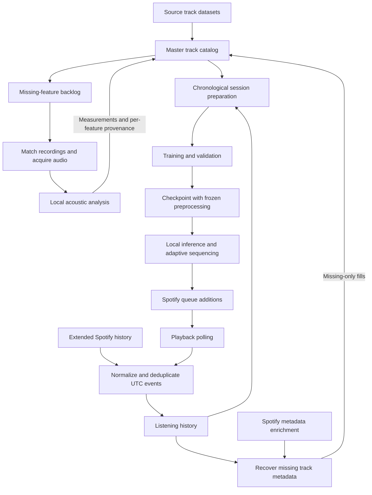
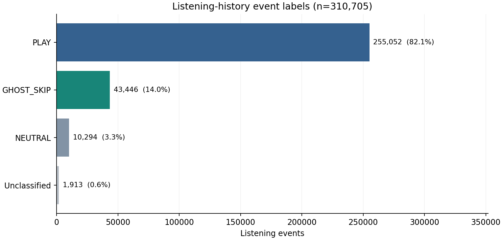
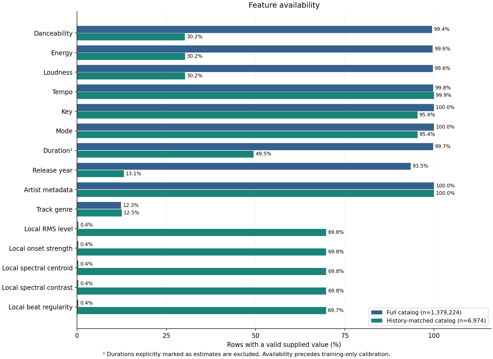
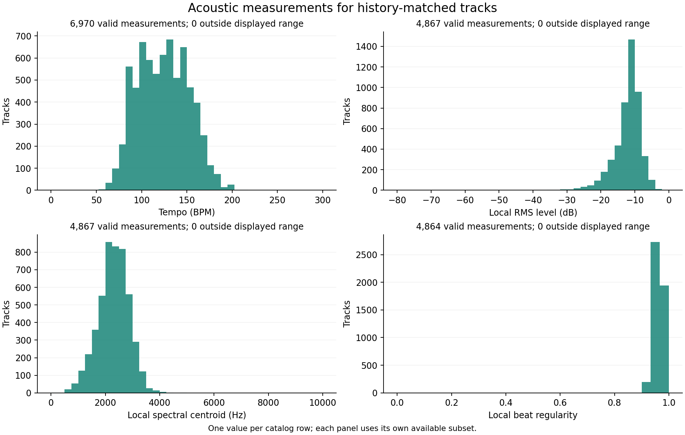
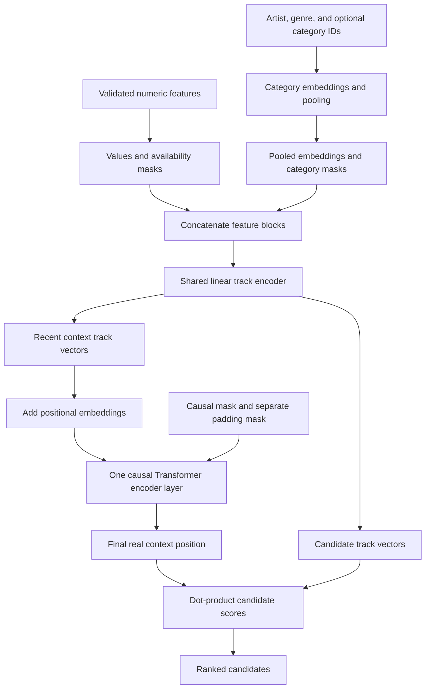
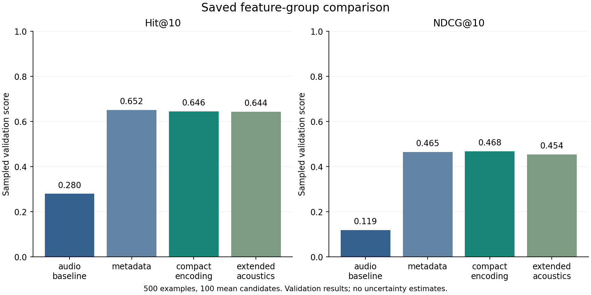

# ShuffleRec

**Personal music recommendation and adaptive sequencing with a SASRec-inspired Transformer.**

ShuffleRec combines Spotify listening history, track metadata, and audio features to recommend what to play next. The model uses recent listening context to rank tracks, while a separate sequencer builds a queue that balances those rankings with variety and responds to playback feedback.

The project covers the full path from raw listening records to live playback: importing and normalizing history, maintaining a shared track catalog, extracting missing acoustic measurements, training and comparing models, and connecting local inference to Spotify. This README describes the work completed so far, the evidence behind the current choices, and the limitations that still need further experimentation.

## Contents

- [Project structure](#project-structure)
- [Data pipeline](#data-pipeline)
- [Dataset snapshot](#dataset-snapshot)
- [Features and missing data](#features-and-missing-data)
- [Model architecture](#model-architecture)
- [Training and evaluation](#training-and-evaluation)
- [Preliminary model comparison](#preliminary-model-comparison)
- [Adaptive sequencing and live playback](#adaptive-sequencing-and-live-playback)
- [Setup and usage](#setup-and-usage)
- [Reproducing the figures](#reproducing-the-figures)
- [Current limitations and further work](#current-limitations-and-further-work)
- [Detailed guides](#detailed-guides)

## Project structure

| Location | Role |
| --- | --- |
| `notebooks/ShuffleRec.ipynb` | Main notebook for data preparation, model training, feature comparisons, and evaluation |
| `shufflerec/` | Shared preprocessing, chronological datasets, model, training, inference, and sequencing logic |
| `scripts/` | History import, playback polling, catalog merging, metadata enrichment, and audio extraction |
| `data/` | Master track table, extraction backlog, and private metadata checkpoints |
| `sensitive_info/` | Private history, source datasets, credentials, runtime settings, and model artifacts |
| `tests/` | Offline regression tests using synthetic data and simulated services |
| `docs/` | Workflow guides and the aggregate figures used below |

Private listening data, credentials, audio caches, and trained personal checkpoints are kept out of Git. A fresh checkout needs its own data and credentials to reproduce the personal workflow.

## Data pipeline

The master catalog and listening history serve different purposes. Catalog rows describe tracks; history rows describe individual listening events. They are connected through the catalog's `id` field and the history's `track_id` field. The extraction backlog also uses `track_id`.



### Listening history and metadata

Extended Spotify exports are imported through `scripts/import_etended_spotify_history.py`; `scripts/polling.py` records new playback observations. Timestamps are normalized to UTC, and supported history sources are combined and deduplicated before use.

Catalog enrichment starts with information already available locally: alternate catalog columns, history exports, retained source records, and saved metadata responses. Spotify requests fill remaining gaps. Existing nonmissing values are preserved, and newly recovered metadata retains field-level provenance.

Duration needs particular care. Time spent listening is not automatically the recording's duration. Unqualified history values remain candidates, while consistent completed-play evidence can supply explicitly labeled estimates. The default model preprocessing excludes durations marked as estimated.

### Audio acquisition and analysis

`scripts/feature_extraction.py` first checks the local audio cache. If audio is unavailable, it searches for a recording and checks title, artist, version, and available duration evidence before downloading. Requested remixes, language versions, and live recordings are treated as distinct recording identities. These checks reduce mismatches, but cannot prove that a source is the exact Spotify recording.

Acquisition and analysis use separate worker pools, with one coordinator responsible for catalog updates. The default analysis window is the first 60 seconds; full-recording analysis is also available. Each newly filled feature records its extractor version, audio source, and actual analyzed duration. Failed attempts remain in the backlog with an error reason for later review.

Updates are missing-only. Atomic CSV replacement and change detection protect ordinary saves, but concurrent writers to the same catalog or backlog are unsupported. Metadata can be fetched into a separate checkpoint while extraction runs, then applied after the other writer has stopped.

The [data pipeline reference](docs/data-pipeline.md) covers matching rules, local recovery, staged metadata fetching, retries, authentication, and interrupted-save recovery.

## Dataset snapshot

The following figures summarize the local inputs inspected on **31 October 2026**. They are a snapshot of an evolving dataset, rather than fixed properties of the project or the inputs used by every earlier experiment.

| Dataset | Size |
| --- | ---: |
| Master catalog | 1,379,224 track records |
| Listening history | 310,705 events |
| Distinct track identifiers in history | 8,170 |
| Catalog rows matched to history | 6,974 |

The history identifier count is measured before matching to the catalog or filtering model inputs. It should not be read as the number of usable training tracks.

### Listening-event composition



Most recorded events are labeled `PLAY`, followed by `GHOST_SKIP` and `NEUTRAL`. Rows without an event label are shown separately. These are the labels already stored in the history, rather than labels reconstructed for this figure. Neutral and unrecognized events reset training context; they are not silently treated as positive plays.

### Feature availability



The two groups answer different questions: how complete is the full catalog, and how much information is available for tracks that occur in listening history? Coverage is measured per catalog row, so frequently played tracks do not receive extra weight.

The plot applies the preprocessing value checks and excludes explicitly estimated durations. It shows supplied feature availability before training-only calibration; a feature with no valid training observations will still be masked by the fitted preprocessor. Local measurements cover less than 1% of the full catalog, but roughly 70% of its history-matched tracks. That difference makes the smaller group a useful view of the data available for personal recommendations.

### Acoustic distributions



These distributions use history-matched catalog rows, with one observation per track record. Each panel reports its own valid sample count because feature coverage differs. Values outside the displayed ranges are counted in the panel captions rather than clipped into the edge bins. The local measurements describe the analyzed audio segment, which may cover only part of a recording.

## Features and missing data

The feature pipeline combines numerical measurements with categorical metadata. Input groups can be enabled independently for comparisons, and the same fitted transformations are saved with the model for inference.

| Feature group | Inputs and handling |
| --- | --- |
| Original audio properties | Danceability, energy, loudness, speechiness, acousticness, instrumentalness, liveness, valence, tempo, and mode |
| Musical key and meter | Circular sine/cosine key encoding and a categorical time-signature embedding in the compact preset; alternative encodings remain available |
| Track metadata | Artist identities, represented release year, duration, and track genre; artist genres use a separate vocabulary when present |
| Local acoustics | RMS level in dB, onset strength, spectral centroid in Hz, spectral contrast, and beat regularity |
| Extraction provenance | Availability of recognized local extraction markers and log-transformed analysis durations for locally extractable properties |
| Optional inputs | Album identity and popularity are configurable; explicit-content flags are not model inputs |

Local RMS level is not Spotify loudness, onset strength is not energy, and beat regularity is not danceability. These measurements remain separate features so the model can learn whether they contribute useful information.

Missing numeric data uses NaN in the source tables. During transformation, values receive numerical inputs and separate availability masks. A missing value therefore remains distinguishable from a real zero. Invalid legacy sentinels are rejected according to each feature's meaning; negative dB values remain valid where appropriate.

Category vocabularies and numerical ranges are fitted on training-session tracks only. Unknown categories, missing features, and sequence padding are handled separately. Artist and genre lists are pooled into fixed-width representations, while track genres and artist genres retain their separate meanings. Unused source metadata stays in the catalog for future experiments.

## Model architecture

The current network uses a shared track encoder and a single causal Transformer layer. It is inspired by SASRec's sequential ranking approach, with track representations built from attributes rather than a dedicated learned embedding for every track ID. This allows a new track with usable metadata or acoustic features to be represented without adding an item-specific embedding.



The default architecture uses a **128-dimensional track representation**, **8 attention heads**, a **2,048-dimensional feed-forward block**, and **0.1 dropout**. The notebook uses up to **10 context tracks**. Shorter contexts are right-aligned and padded, with padding excluded from real-position attention.

Context and candidate tracks pass through the same track encoder. The last real context state is scored against candidate vectors using dot products. These scores express relative ranking, not calibrated probabilities of acceptance. At inference, candidate vectors can be cached while context states are recomputed for each planned slot.

Parameter counts depend on enabled features and training vocabularies. The saved compact-encoding comparison model below has **616,500 parameters**; this is a property of that fitted run, rather than a fixed network size for all datasets.

## Training and evaluation

### Chronological preparation

Events are grouped into sessions using a **20-minute gap**. Complete sessions are split approximately **80/10/10 by session count** into training, validation, and test partitions. Event and example proportions can differ from those percentages, and context never crosses a partition boundary.

Accepted historical plays extend context and form next-item targets. Ghost skips can provide negative preference pairs against a subsequent play. Neutral events and tracks without usable model inputs reset context, preserving the same behavior in training and inference.

### Ranking objective and model selection

Training uses a pairwise ranking loss that favors a positive track over a negative one. The workflow supports a next-item phase followed by an optional skip-preference phase. Validation NDCG selects the best weights across both phases, so a weaker preference phase does not replace a better next-item checkpoint.

The current notebook selects a single `compact_encoding` training run. Comparisons are available separately, and the current settings leave preference training and final-test evaluation disabled. Review the settings cell before running the notebook: executing all cells can start training, even though simply opening it does not.

### What the metrics measure

Evaluation uses **Hit@10** and **NDCG@10**. Hit@10 measures whether the target appears in the first ten positions; NDCG@10 also rewards placing it nearer the top.

The default evaluation samples up to 99 unique negatives per target, excluding context tracks. Candidate identities and ordering are fixed for repeated validation checks. Feature comparisons use common validation examples and candidate sets so that the variants face the same ranking task.

These are sampled ranking metrics. They do not measure full-catalog retrieval or establish how well a live session will perform. The default candidate universe is a retrospective catalog snapshot of tracks occurring in the supplied history, including held-out identities. It does not reconstruct which tracks or metadata were available at each historical moment.

Checkpoints package model weights, configuration, fitted preprocessing, and run metadata together. They are inference artifacts rather than optimizer-state resumptions, and should remain private because they contain fitted personal vocabularies and weights. See the [model workflow guide](docs/model-training.md) for configuration and artifact details.

## Preliminary model comparison

The saved **28 October 2026** feature-group comparison provides an initial view of how the input choices affect ranking. All four variants were evaluated on **500 shared validation examples**, with **100 candidates per example**, using seed **42**.



| Variant | Main input change | Hit@10 | NDCG@10 | Parameters |
| --- | --- | ---: | ---: | ---: |
| Audio baseline | Audio properties with the baseline key/meter encodings | 0.280 | 0.119 | 597,504 |
| Metadata | Adds artist, genre, year, and duration inputs | 0.652 | 0.465 | 616,104 |
| Compact encoding | Uses circular key and categorical time-signature encoding | 0.646 | 0.468 | 616,500 |
| Extended acoustics | Adds local acoustic measurements and extraction provenance | 0.644 | 0.454 | 621,876 |

The largest improvement in this run came from adding metadata. Compact encoding produced the highest NDCG@10, while the metadata variant had the highest Hit@10. Their small difference needs repeated experiments before it can support a stronger conclusion. Adding local acoustics did not improve the recorded validation scores in this comparison.

These results come from one saved experiment, without repeated-seed uncertainty estimates. The report records no final-test evaluation. Its source snapshot also predates the current dataset figures, so the two should not be interpreted as one freshly repeated experiment. A later standalone compact-model training run is a separate result and is not mixed into this comparison.

## Adaptive sequencing and live playback

Ranking a track and deciding to queue it are separate steps. The sequencer combines three candidate pools:

| Pool | Purpose |
| --- | --- |
| Random | Keep some exploration within the supplied playlist |
| Top-ranked | Favor tracks with strong model scores |
| Filtered | Introduce artist/genre relationships with rank weighting and variety controls |

Pool preferences adapt to acceptance and rejection feedback. Recent-track exclusions, fatigue penalties, and duplicate checks help avoid repetitive queues. The default plan contains **five upcoming tracks**. Later slots use earlier planned tracks as provisional context; unheard suggestions never become confirmed listening history just because they were planned.

This adaptation changes sequencing policy and future selections. The model weights and fitted preprocessing remain frozen during playback.

### Offline and live operation

The offline interface takes playlist IDs and accepted context from local CSV files and supports JSON feedback without contacting Spotify. The live pipeline reads the active Spotify playlist, prepares local inference, and replenishes the upcoming queue as playback progresses.

Live queue additions are committed once Spotify acknowledges them. Feedback changes future additions, but cannot freely replace songs already submitted. The pipeline preserves manually queued songs and withholds additions when playback or source conditions do not permit them. It does not start playback, transfer devices, skip tracks, clear the queue, or edit the playlist.

Playback tracking uses conservative evidence when observations are missing. Uncertain intervening tracks are not fabricated as measured listening-history rows; separate feedback records retain the inference and confidence information.

### Feedback thresholds

Historical training labels and live acceptance answer different questions and deliberately use different thresholds:

| Signal | Default interpretation |
| --- | --- |
| Historical `PLAY` | At least 70% completion, or an explicit completed-track reason |
| Historical `GHOST_SKIP` | Confirmed skip below 15% completion under the history classifier |
| Sequencer acceptance | At least 25% completion |
| Early sequencer rejection | Below 25%, with qualifying skip/transition evidence |

Incomplete or uncertain observations may remain neutral or unresolved. The [adaptive playback guide](docs/adaptive-playback.md) explains evidence weights and polling behavior; the [sequencing guide](docs/sequencing.md) describes pool controls and feedback commands.

## Setup and usage

Run commands from the repository root, using the same Python environment for the notebook kernel and command-line tools.

### Dependencies

| Workflow | Requirements |
| --- | --- |
| Training and offline inference | `requirements-model.txt` |
| Live Spotify integration | Model requirements plus `requirements-spotify.txt` |
| Audio acquisition and extraction | `requirements-audio.txt` |
| README plots | `requirements-docs.txt` |

```powershell
python -m pip install -r requirements-model.txt -r requirements-spotify.txt -r requirements-audio.txt -r requirements-docs.txt
```

Audio processing also needs **FFmpeg and ffprobe** on PATH. YouTube extraction uses **Node.js 22+ or Deno 2.3+** for JavaScript support. Notebook use needs Jupyter and a kernel in the selected environment. Dependency files specify compatible ranges rather than an exact environment lock.

Spotify integration uses private OAuth credentials in `sensitive_info/spotify_credentials.json`, with `client_id`, `client_secret`, and `redirect_uri`. Live operation additionally reads `sensitive_info/spotify_pipeline.json` to select a local checkpoint and runtime settings. Use placeholder examples from the [live guide](docs/live-pipeline.md) and [playback guide](docs/adaptive-playback.md); personal credentials and model files are not bundled.

### Inspect and prepare data

```powershell
# Read-only aggregate audit of the catalog and history.
python -m shufflerec.audit --master data/master_track_table.csv --history sensitive_info/spotify_listening_history.csv

# Preview missing-only metadata recovery from supported local sources.
python scripts/data_merging.py --backfill-local --dry-run

# Inspect a small audio backlog sample using existing local audio only.
python scripts/feature_extraction.py --dry-run --limit 10
```

After reviewing the local metadata preview, omit `--dry-run` to apply the fills. Run only one writer per target CSV. For online enrichment, large audio runs, or recovery after errors, follow the [data pipeline reference](docs/data-pipeline.md).

### Train a model

Open [notebooks/ShuffleRec.ipynb](notebooks/ShuffleRec.ipynb), inspect the settings cell, and run the preparation and training cells. The main controls are `RUN_TRAINING`, `TRAINING_VARIANT`, `RUN_COMPARISON`, and `RUN_FINAL_TEST`. New runs are written under the ignored `sensitive_info/model_runs/` directory without overwriting existing checkpoints.

Use comparison mode to investigate features, then train the selected configuration separately to save an inference checkpoint. Keep final-test evaluation separate from configuration selection.

### Run offline sequencing

```powershell
python -m shufflerec.sequence --checkpoint sensitive_info/model_runs/YOUR_RUN/model.pt --catalog data/master_track_table.csv --playlist sensitive_info/playlist.csv --context sensitive_info/accepted_context.csv --once
```

Replace `YOUR_RUN` with a saved run. Playlist and context files need a `track_id` column; context must contain accepted plays in oldest-to-newest order, rather than unfiltered history. Without `--once`, the process accepts JSON commands for a persistent offline session. See [offline sequencing](docs/sequencing.md).

### Run with Spotify

Start a playlist in Spotify, then preview the live plan:

```powershell
python -m shufflerec.live --dry-run --once
```

This performs authenticated Spotify reads and may refresh the token cache, but does not submit songs or write listening/evidence logs. Once private settings select the intended checkpoint, run continuously with:

```powershell
python -m shufflerec.live
```

Live operation adds tracks to the active device's queue and records playback observations. Credentials, permissions, proxy routing, request budgets, and recovery behavior are covered in the [live pipeline guide](docs/live-pipeline.md).

### Run tests

```powershell
python -m pytest -q
```

Tests use synthetic catalogs, temporary files, generated test audio, and simulated service boundaries. They do not need personal listening records or live Spotify access. In restricted environments, use a fresh writable directory under `.test-runs` with `--basetemp`.

## Reproducing the figures

The figures are produced with Matplotlib by [scripts/plot_readme.py](scripts/plot_readme.py). Pipeline and architecture diagrams are written directly in Mermaid Markdown. No image-generation model is used.

```powershell
python -m pip install -r requirements-docs.txt
python -m scripts.plot_readme --comparison sensitive_info/model_runs/comparison-20261028T192832Z-85d56b51/comparison_results.json
```

The explicit comparison path identifies the saved report behind the results table. On another installation, supply the corresponding private report. Omitting `--comparison` regenerates the three dataset figures without a model-comparison figure. No training runs are started.

The script reads the catalog and history without modifying them, streams catalog rows in chunks, and checks input size/modification signatures for changes during collection. It writes figures and an [aggregate snapshot](docs/images/readme_snapshot.json) under `docs/images/`. The exported snapshot contains counts, histogram bins, and selected validation metrics; it excludes track IDs, artist names, listening timestamps, credentials, and private source paths.

Use `--master`, `--history`, and `--output` to select other inputs or an output directory. Generate figures against stable inputs, then update the dataset table and figure discussion if the snapshot changes. Omitting a comparison does not remove an existing comparison image, so keep the results section tied to the intended saved report.

## Current limitations and further work

The data and playback workflow are implemented, along with training, feature comparisons, checkpoint loading, and adaptive sequencing. The model results remain preliminary, and implementation tests are not evidence of recommendation quality in everyday use.

- **Personal scope:** one listener's history cannot establish how the approach generalizes to other users.
- **Retrospective evaluation:** catalog membership and metadata reflect a supplied snapshot, rather than a fully reconstructed historical catalog.
- **Sampled ranking:** validation uses small candidate sets; full-catalog evaluation and broader baselines remain useful next steps.
- **Uneven feature coverage:** local acoustics are available for a limited subset, and recording matching and segment length introduce additional uncertainty.
- **Experiment depth:** repeated seeds, individual-feature ablations, and a held-out final evaluation are needed before drawing firm conclusions about feature choices.
- **Live evidence:** Spotify queue constraints, polling gaps, and uncertain playback transitions limit what feedback can establish. Offline tests do not replace a measured live evaluation.

## Detailed guides

This README is the main project overview. The following documents retain the operational detail needed for particular workflows:

| Guide | Contents |
| --- | --- |
| [Data pipeline reference](docs/data-pipeline.md) | Metadata recovery, audio matching, extraction options, retries, rate limits, and save recovery |
| [Model workflow](docs/model-training.md) | Feature contracts, chronological preparation, experiment settings, checkpoint compatibility, and evaluation protocol |
| [Offline sequencing](docs/sequencing.md) | Candidate pools, JSON commands, feedback, and session limitations |
| [Live Spotify pipeline](docs/live-pipeline.md) | Private settings, playlist handling, queue commitments, routing, and recovery |
| [Adaptive playback](docs/adaptive-playback.md) | Polling, conservative evidence, history compatibility, and feedback thresholds |
| [Model design notes](docs/model-tweaks-design.md) | Background to the feature and training changes |
| [Historical progress notes](docs/model-tweaks-progress.md) | Earlier implementation snapshots; their counts and status are not current results |
